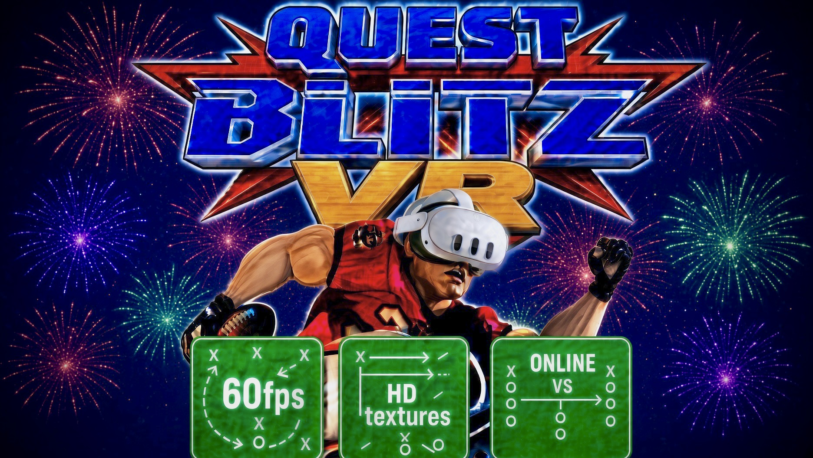
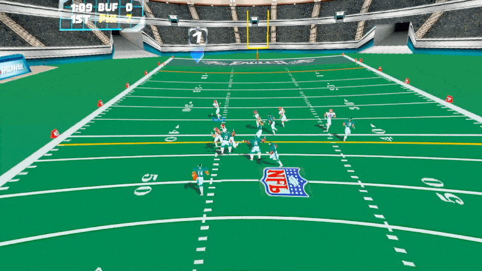

# NFL Blitz VR: Meta Quest 3 Standalone

NFL Blitz 2000 running natively on the Meta Quest 3, in VR, at 60 fps with HD textures and online play.

> **⚠️ YOU MUST OWN THE GAME.** This project does not include NFL Blitz 2000 or any of its assets. Bring your own ROM, made from your own cartridge (NFL Blitz 2000, USA, Rev 1). Do not ask for ROMs.

## Features

- **60 FPS**, smooth in-between pictures at 120 Hz.
- **HD textures:** screens and menus upscaled 4x.
- **Big curved screen:** the game's own camera on a wide screen wrapped around you; look around freely.
- **Online VS:** 2 to 4 players, each on their own Quest, with a room code. Online play uses a small free Cloudflare Worker as the meeting point (see below).
- **Plug and play:** pick your ROM in the start window and play.

## Install

1. Download the APK from the [Releases](../../releases) page.
2. Install it with SideQuest (or `adb install`).
3. Start it from **Library > Unknown Sources**.
4. In the start window, choose your NFL Blitz 2000 (USA) ROM. The game checks the file and remembers it; after that just press **Play**.

## Controls

| Button | Action |
|---|---|
| Left stick | Move |
| A / B | A / B |
| Either trigger | Z (turbo) |
| Right grip | R |
| Right stick | C buttons |
| Left menu button | Start / pause |

## Online play

1. Everyone uses the same version of the app.
2. One player taps **Host (get a code)** and shares the code; the others tap **Join (enter a code)**.
3. The host presses Start once everyone has joined (2 to 4 players). The host's options are the game everyone plays.

**Cloudflare (brief):** players find each other through a small relay, a free Cloudflare Worker. The app uses a shared one by default, so nothing to set up. To run your own: create a free Cloudflare account, deploy a Worker that relays WebSocket rooms, and put its `wss://...workers.dev` address in a file named `relay.txt` in the app's folder (`/sdcard/Android/data/com.blitz2000.recompiled/files/`). Only game inputs pass through it; no game data or ROM does.

## What's new in 0.1.55

- First release.

## Credits

Built on [N64Recomp](https://github.com/N64Recomp/N64Recomp), [N64ModernRuntime](https://github.com/N64Recomp/N64ModernRuntime) and [RT64](https://github.com/rt64/rt64). NFL Blitz is a trademark of its owners; this is an unofficial fan project.
